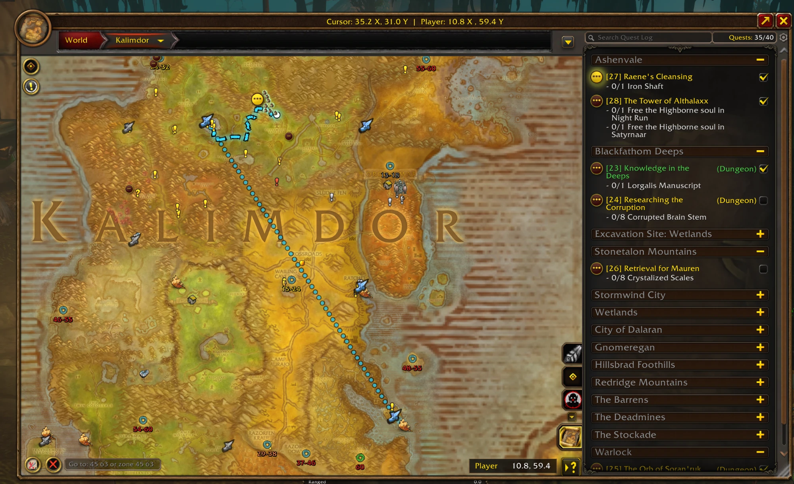
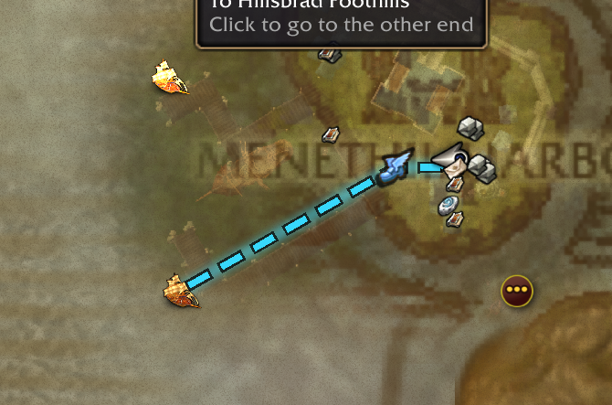
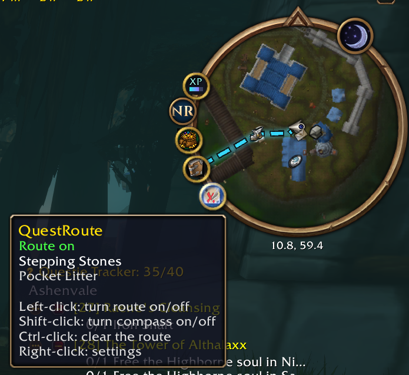
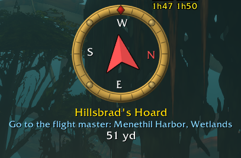
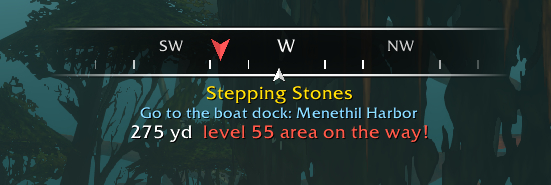
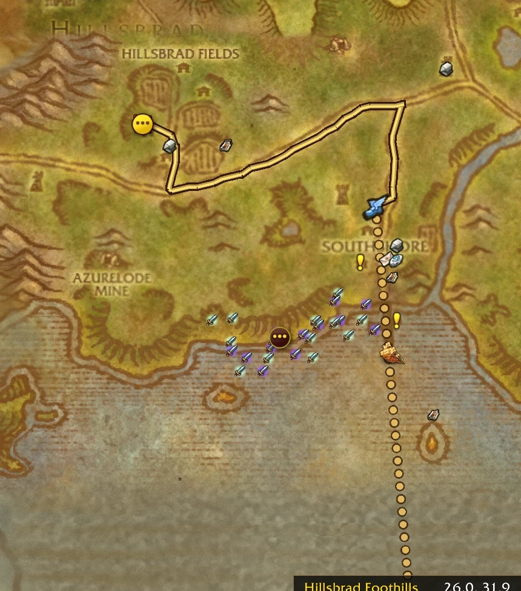
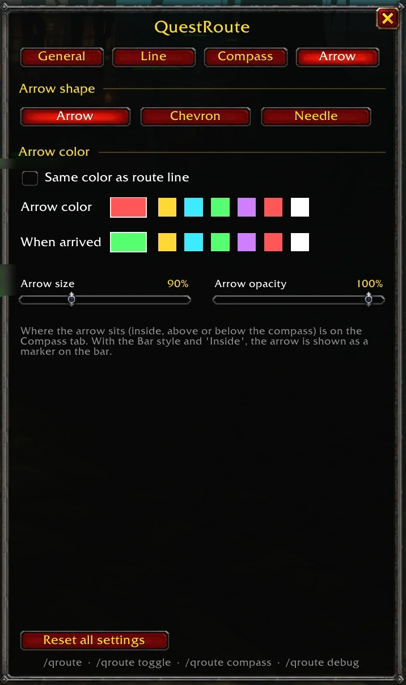

# QuestRoute
QuestRoute automatically maps out the best route to whatever quest you click: no manual waypoints.

Draws the route on the world map and minimap, along roads where they exist
Uses boats, zeppelins, airships, the Deeprun Tram, the Darnassus portal and the flight paths you’ve unlocked
On-screen compass and arrow, fully customizable (or turn it off)
Avoids areas well above your level
Runs you back to your corpse when you die
Map waypoint button and a coordinate search box
Built for WoW Forever (Classic+), works alongside Questie and OpenMap

## Screenshots

| | |
|---|---|
|  |  |
| Route across Kalimdor: walk, fly, walk to the quest | Leading to the right boat dock in Menethil Harbor |
|  |  |
| The route on the minimap, plus the minimap button | WoW Gold compass with the next step |
|  |  |
| Bar compass, warning about a high-level area on the way | WoW Gold line theme: road to the flight master, then the boat |
|  | |
| Settings: arrow shape, colours and size | |
